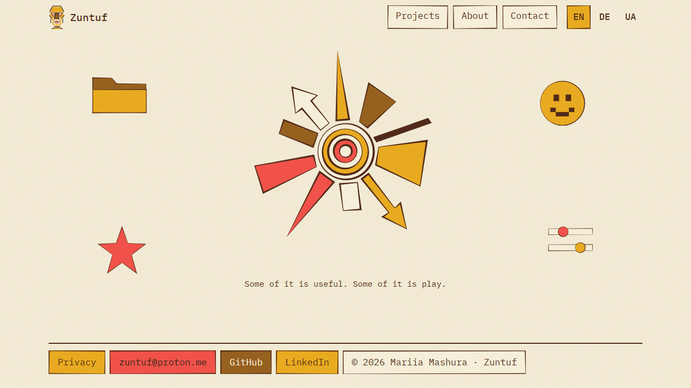
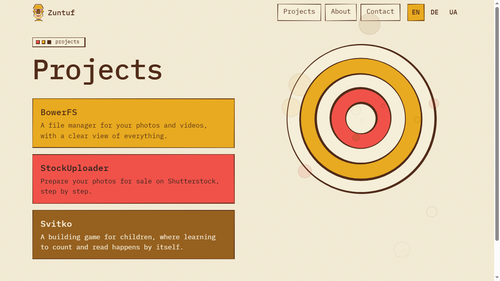
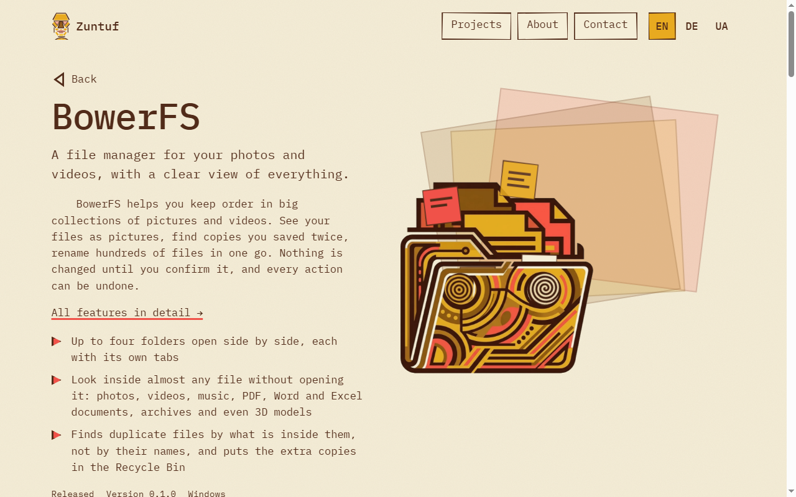
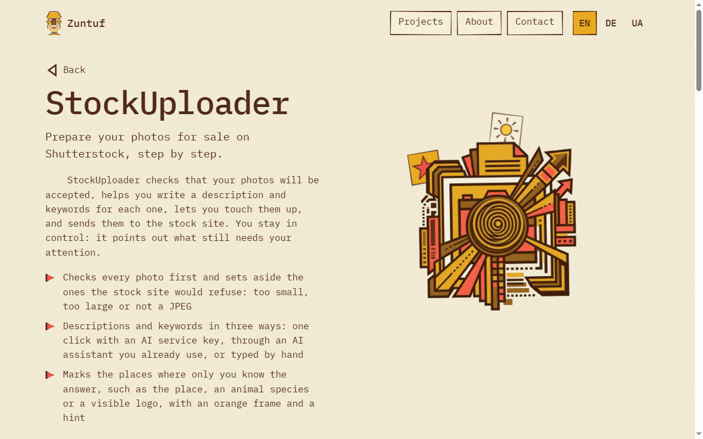
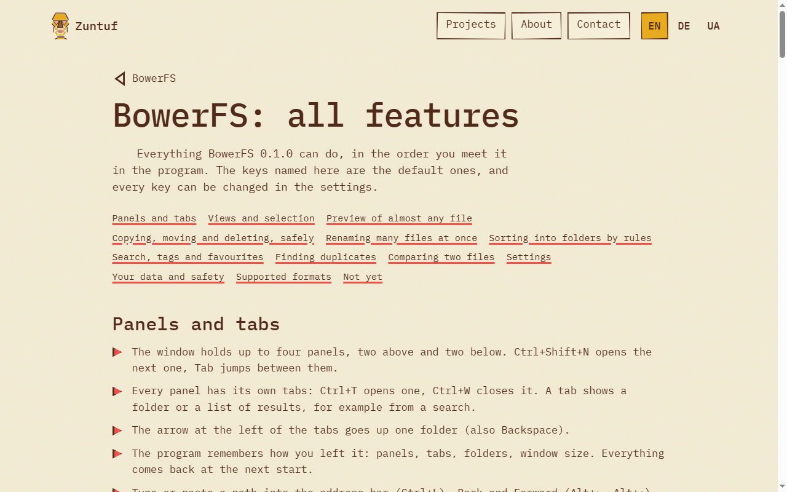
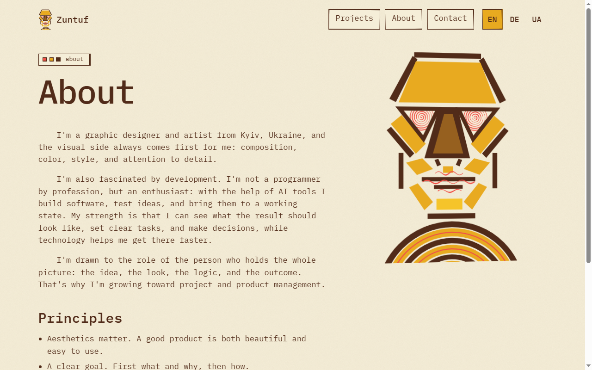
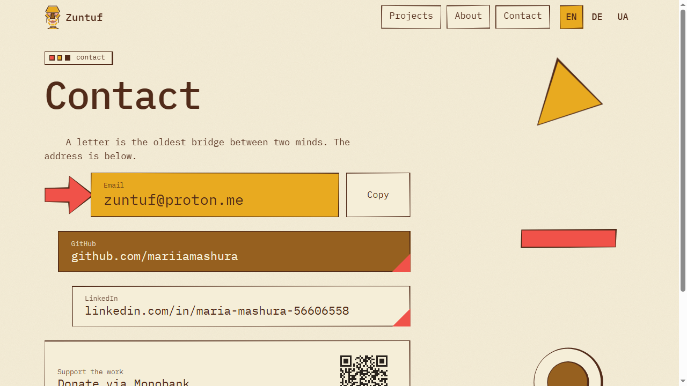
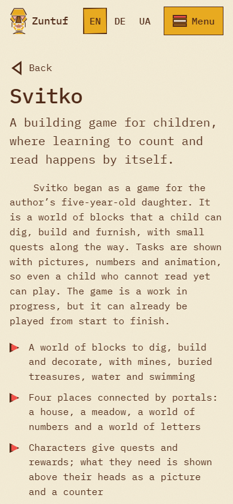

# Zuntuf

Source of the **Zuntuf** website: a small, hand-drawn home for useful and playful Windows software by one independent author, [Mariia Mashura](https://github.com/mariiamashura). It is a static, multilingual (English, German, Ukrainian) site in a constructivist style, built with [Astro](https://astro.build), TypeScript and plain browser scripts. No cookies, no analytics, no tracking.

> **Licence: all rights reserved.** The repository is public so the work can be read and checked, but it is not open source. Please read [Licence and authorship](#licence-and-authorship) before reusing anything.

## What is on the site

- **A star-wheel landing page** that is the logo, the navigation and the intro in one. It plays on desktop; phones get a dedicated, simpler layout.
- **A page per program**, each with a description, screenshots you can open at full size, system requirements, FAQ, privacy note and a download button:
  - **BowerFS**: a file manager for photos and videos, with a separate page listing all features.
  - **StockUploader**: prepares photos for sale on Shutterstock.
  - **Svitko**: a building game for children, where counting and reading are learned by playing.
- **Projects**, **About** and **Contact** pages, a privacy page and a short film.
- **Three languages** (`/en/`, `/de/`, `/ua/`) with correct `hreflang`, canonical links, sitemap, Open Graph / Twitter cards and schema.org data.

## Screenshots

| | |
|---|---|
|  |  |
|  |  |
|  |  |
|  |  |

## Quick start

Requires Node.js 20 or newer.

```bash
npm install
npm run dev        # http://localhost:4321/
npm run build      # static site into dist/
npm run preview    # serve dist/ locally
```

Page addresses end with a slash, for example `/en/about/`.

## Project layout

| Path | What it is |
|------|------------|
| `src/pages/` | Routes: `[lang]/…` pages for `en`, `de`, `ua`, the 404 page and the root redirect |
| `src/components/` | Star wheel, software glyphs, program artwork, logo, face, image viewer |
| `src/scripts/` | Browser scripts: intro, ripples, wheel interaction, parallax, menu |
| `src/lib/` | Wheel geometry, artwork configs, face, content helpers |
| `src/content/tools/` | **One JSON file per program.** Add a file, get a page and a ray on the wheel |
| `src/data/` | Longer texts: the BowerFS feature list, the About page |
| `src/locales/` | Interface strings and page metadata: `en.json`, `de.json`, `ua.json` |
| `src/config/` | `site.ts` (name, email, social links, feature flags), `motion.ts` (intro timings) |
| `src/styles/` | Design tokens and global styles |
| `public/` | Static files: favicon, social preview image, program artwork and screenshots |
| `scripts/` | Developer utilities (wheel checks, favicon and cut-out generators) |
| `screenshots/` | The images used in this README |

## Adding a program

Create `src/content/tools/<slug>.json`. The schema is in `src/content.config.ts`; any field you leave out is simply not shown. Texts live per language under `i18n`, and a missing German or Ukrainian field falls back to English. Set `"draft": true` to hide an entry in production.

Screenshots go to `public/tools/<slug>/shots/` and are listed in the JSON. Download buttons come from `platforms[].downloadUrl` (for example a GitHub release asset).

## Languages

Internal locale codes are `en`, `de`, `ua`. The Ukrainian site is served under `/ua/`, while its HTML `lang` and sitemap `hreflang` are the correct `uk`.

## Configuration

- `src/config/site.ts`: site name, contact email, `social.github` and `social.linkedin` (an empty value hides the link), feature flags.
- `SITE_URL` environment variable: the public origin used for canonical links, the sitemap and social previews. Set it for the real build, for example `SITE_URL=https://example.org npm run build`. Also update the sitemap line in `public/robots.txt`.
- `SHOW_DRAFTS=1`: include draft entries.

## Behaviour notes

- The wheel and intro load only on devices that match `(min-width: 900px) and (hover: hover) and (pointer: fine)`. Everything else gets the phone layout.
- The intro plays on a refresh or a fresh visit to a language home page and never with `prefers-reduced-motion`. Add `?intro` to force it.
- Screenshots are viewable at full size with a built-in viewer (click, Esc to close).

## Deployment

`npm run build` produces a plain static site in `dist/`, ready for any static host (Cloudflare Pages or Workers, GitHub Pages, Netlify, nginx).

## Licence and authorship

**All rights reserved, © 2026 Mariia Mashura.** The code, design, logo, artwork, text and screenshots may not be copied, modified or redistributed without written permission. Viewing the repository and cloning it for personal study is fine. See [LICENSE](LICENSE).

**Authorship of the artwork.** The logo and the head (face) image are original works by the author. The source of their concept is not digital art; it is the author's own authorial artwork.

Third-party components (IBM Plex Mono under the SIL Open Font License 1.1, Astro and others under permissive licences) are listed in [NOTICE.md](NOTICE.md). The programs BowerFS, StockUploader and Svitko are separate works and are not part of this repository.

## Contact

[zuntuf@proton.me](mailto:zuntuf@proton.me) · [GitHub](https://github.com/mariiamashura) · [LinkedIn](https://www.linkedin.com/in/maria-mashura-56606558)
